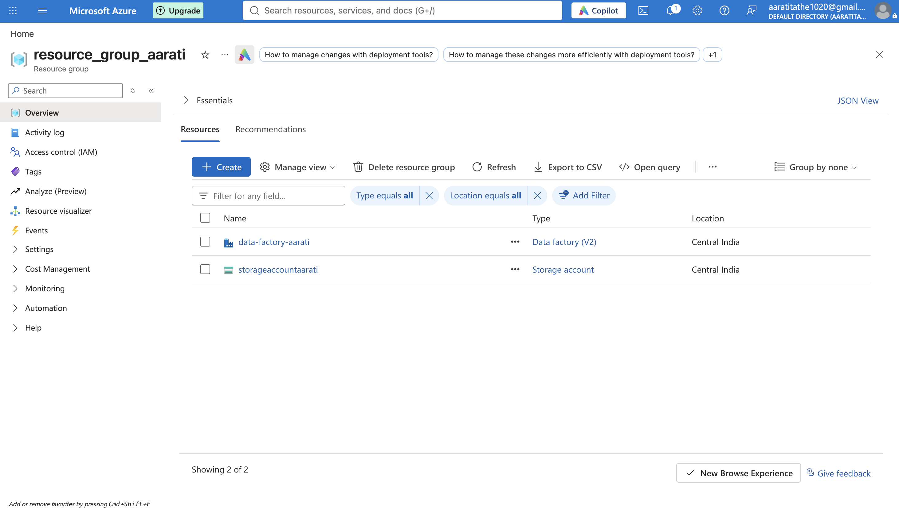
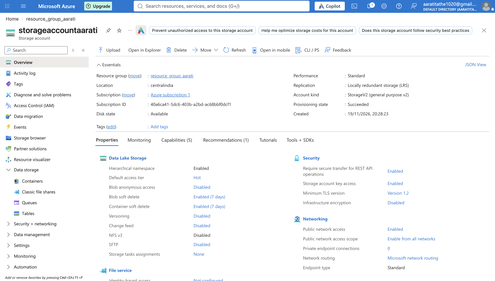
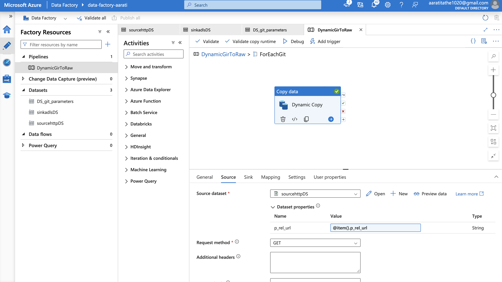
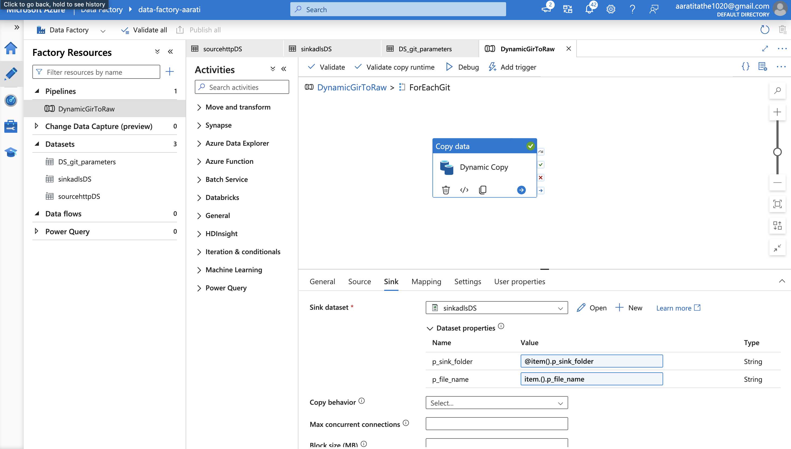
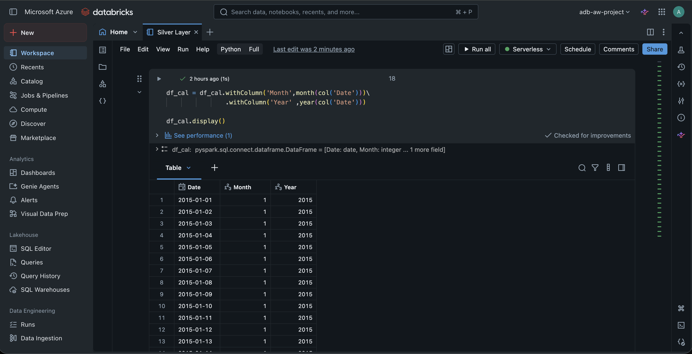
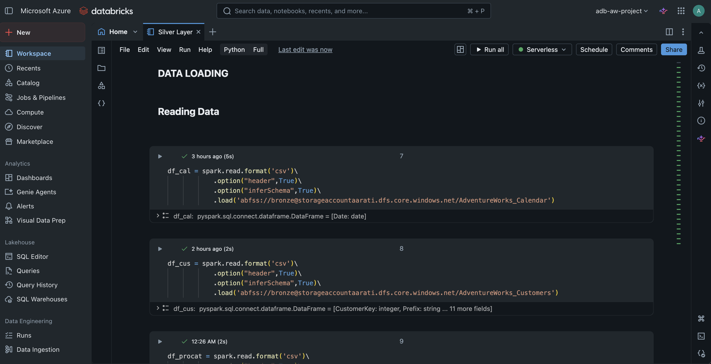
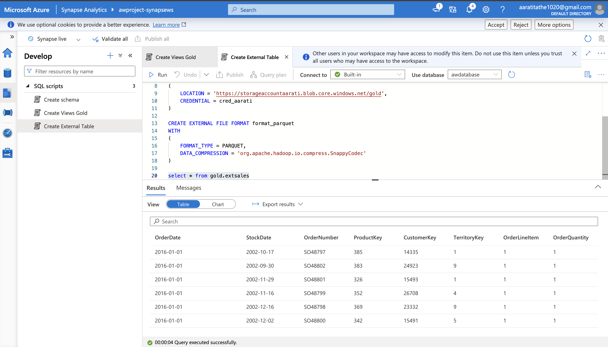

#🚀 API-Driven End-to-End Data Engineering Pipeline – Microsoft Azure

## 📌 Project Overview

This project demonstrates an end-to-end cloud-based data engineering solution using Microsoft Azure services and the Medallion Architecture (Bronze, Silver, and Gold).

The API-Driven End-to-End Data Engineering Pipeline uses GitHub as the data source for AdventureWorks business data. Azure Data Factory manages data ingestion, Azure Data Lake Storage Gen2 stores raw and processed data, and Azure Databricks with PySpark performs data transformations.

The transformed data is made available through Azure Synapse Analytics for querying and Power BI for reporting and visualization.

## 🎯 Business Objective

To develop a scalable cloud-based data engineering pipeline that retrieves data from GitHub, ingests and stores raw data, processes it using Azure Databricks, and prepares structured, analytics-ready datasets for business reporting.

## 🏗️ Project Architecture

## 🛠️ Technology Stack

- GitHub API – Data Source
- Microsoft Azure
- Azure Data Factory
- Azure Data Lake Storage Gen2
- Azure Databricks
- Apache Spark
- PySpark
- Azure Synapse Analytics
- SQL
- Power BI
- GitHub

##  🏗️ Medallion Architecture 

### 🥉 Bronze Layer – Raw Data Ingestion

- Source: GitHub API – AdventureWorks dataset.
- Ingestion: Azure Data Factory dynamic copy pipeline.
- Storage: Azure Data Lake Storage Gen2.
- Stores raw source files for further processing.
  
### 🥈 Silver Layer – Data Transformation

- Processing: Azure Databricks.
- Language: PySpark.
- Reads raw datasets from the Bronze layer.
- Performs data cleaning and dimension data transformations.
- Stores transformed datasets in Parquet format in ADLS Gen2.
  
### 🥇 Gold Layer – Analytics and Data Warehousing

- Platform: Azure Synapse Analytics.
- Uses OPENROWSET() to query Parquet files.
- Creates SQL views and external tables.
- Prepares structured data for analytics and reporting.

## 📸 Project Screenshots

### 1. Azure Resources

Storage Account

### 2. Azure Data Factory

ADF – Source Dataset Configuration

ADF – Sink Dataset Configuration

### ADF Pipeline Success

Azure Data Factory – Successful Pipeline Execution

### 3. Bronze Layer

Bronze Layer – Raw Data Storage

### 4. Databricks Transformation

Databricks – Dimension Data Transformation

### 5. Silver Layer

Databricks – Silver Layer Data Loading

Silver Layer – Transformed Data Storage

### 6. Synapse Gold Layer

Synapse Analytics – Gold SQL Views

Synapse Analytics – External Table Creation

Gold Layer – Analytics Data Storage

## 📊 Project Output

✅ Successfully retrieved AdventureWorks data from GitHub API.

✅ Ingested raw data into ADLS Gen2 using Azure Data Factory.

✅ Processed and transformed data using Azure Databricks and PySpark.

✅ Stored transformed datasets in Parquet format in the Silver layer.

✅ Created SQL views and external tables using Azure Synapse Analytics.

✅Prepared analytics-ready data using Medallion Architecture.

## 🎓 Learning Outcomes

- Hands-on experience with Azure Data Engineering services.
- Understanding of API-based data ingestion.
- Practical knowledge of Medallion Architecture.
- Experience with PySpark data transformations.
- Understanding of cloud-based data pipeline development.
- Experience querying Parquet data using Synapse Analytics.
- Knowledge of organizing and documenting projects using GitHub.

## 👩‍💻 Author

Aarati Tathe

[LinkedIn](https://www.linkedin.com/in/aarati-tathe-7549b7263/)

