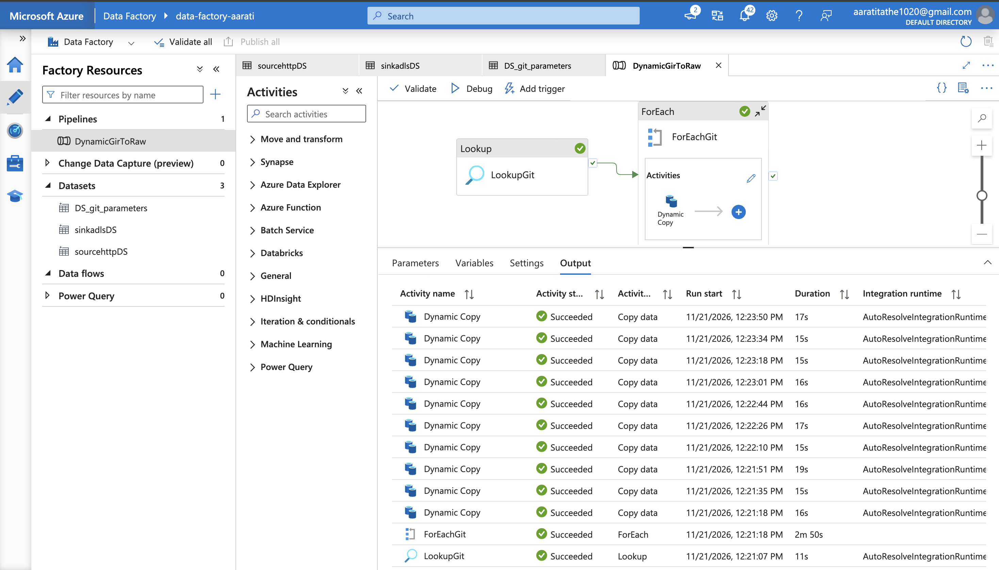
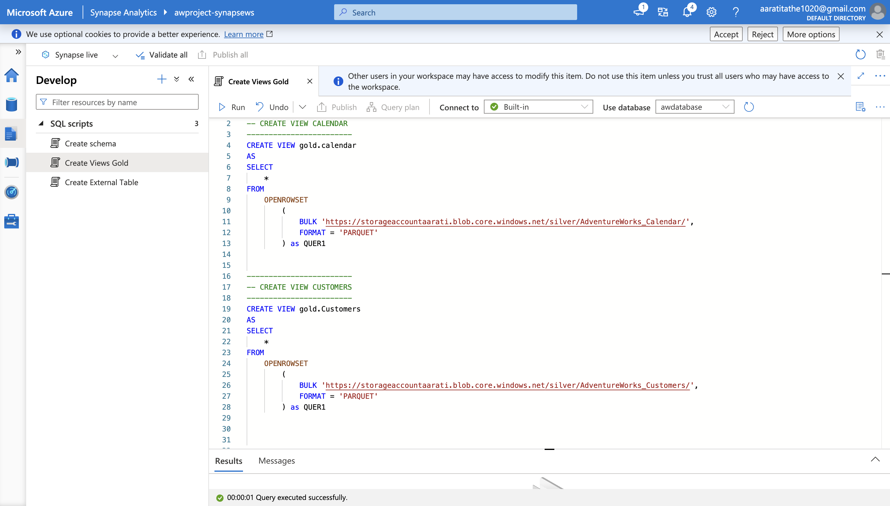

# 🚀 API-Driven End-to-End Data Engineering Pipeline – Microsoft Azure

## 📌 Project Overview

This project demonstrates an end-to-end cloud-based data engineering solution using Microsoft Azure services and the Medallion Architecture (Bronze, Silver, and Gold).

The API-Driven End-to-End Data Engineering Pipeline uses GitHub as the data source for AdventureWorks business data. Azure Data Factory manages data ingestion, Azure Data Lake Storage Gen2 stores raw and processed data, and Azure Databricks with PySpark performs data transformations.

The transformed data is made available through Azure Synapse Analytics for querying and Power BI for reporting and visualization.

## 🎯 Business Objective

To develop a scalable cloud-based data engineering pipeline that retrieves data from GitHub, ingests and stores raw data, processes it using Azure Databricks, and prepares structured, analytics-ready datasets for business reporting.

## 🏗️ Project Architecture

## 🛠️ Technology Stack

- GitHub API – Data Source
- Microsoft Azure
- Azure Data Factory
- Azure Data Lake Storage Gen2
- Azure Databricks
- Apache Spark
- PySpark
- Azure Synapse Analytics
- SQL
- Power BI
- GitHub

## 📸 Project Screenshots

### 1. Azure Resources

Storage Account

### 2. Azure Data Factory

ADF – Source Dataset Configuration

ADF – Sink Dataset Configuration

### ADF Pipeline Success

Azure Data Factory – Successful Pipeline Execution

### 3. Bronze Layer

Bronze Layer – Raw Data Storage

### 4. Databricks Transformation

Databricks – Dimension Data Transformation

### 5. Silver Layer

Databricks – Silver Layer Data Loading

Silver Layer – Transformed Data Storage

### 6. Synapse Gold Layer

Synapse Analytics – Gold SQL Views

Synapse Analytics – External Table Creation

Gold Layer – Analytics Data Storage

🔨 Project Implementation
🔄 Implementation Workflow
1. 🌐 Data Extraction: Retrieve AdventureWorks data from GitHub API.
2. ⚙️ Data Ingestion: Use Azure Data Factory to ingest data into ADLS Gen2.
3. 🥉 Bronze Layer: Store raw data in the Bronze container.
4. 🔥 Data Transformation: Clean and transform data using Azure Databricks and PySpark.
5. 🥈 Silver Layer: Store processed data in Parquet format.
6. 🥇 Gold Layer: Create SQL views and external tables using Azure Synapse Analytics.
7. 📊 Reporting: Prepare analytics-ready data for Power BI.
   

📊 Project Results

✅ Source data retrieved from GitHub.
✅ Data ingested into the Bronze layer.
✅ Data cleaning and transformations performed in the Silver layer.
✅ Transformed datasets stored in Parquet format.
🔄 SQL views and external tables created and validated.
📌 Power BI reports developed.

